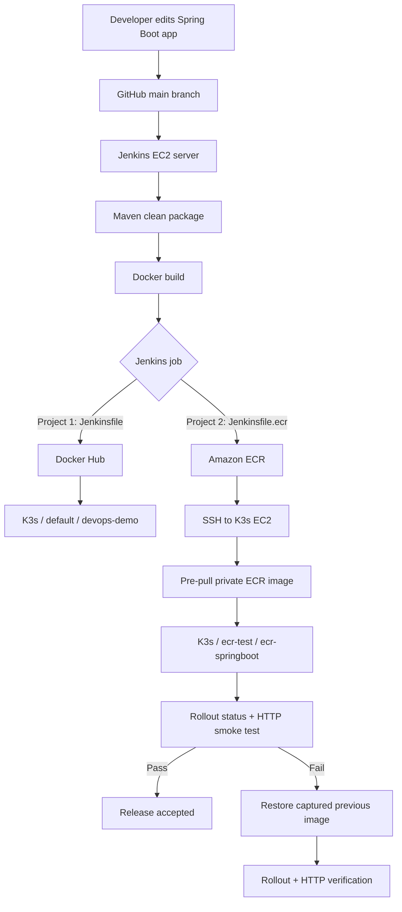

# End-to-End DevOps CI/CD Hands-On Lab

**Jenkins · GitHub · Maven · Docker · Docker Hub · AWS EC2 · IAM · Amazon ECR · Kubernetes (K3s) · Automated Rollback**

> **Status:** Core lab completed and tested, including a successful normal build, manual rollback, intentional deployment-validation failure, automatic image rollback, and successful post-rollback HTTP verification.  
> **Project type:** Personal hands-on learning and interview demonstration; **not** a production deployment.  
> **Repository:** [kamblepraveen/devops-jenkins-demo](https://github.com/kamblepraveen/devops-jenkins-demo)  
> **AWS Region:** `ap-south-1` (Mumbai)  
> **Documentation scope:** Recorded implementation and troubleshooting. Where the exact original configuration or output was not retained, commands are clearly identified as examples rather than claimed test evidence.

---

## Table of contents

1. [Goals and outcomes](#1-goals-and-outcomes)
2. [Overall architecture](#2-overall-architecture)
3. [Tools and their responsibilities](#3-tools-and-their-responsibilities)
4. [Repository structure and separation of projects](#4-repository-structure-and-separation-of-projects)
5. [AWS infrastructure and prerequisites](#5-aws-infrastructure-and-prerequisites)
6. [Local development and Git setup](#6-local-development-and-git-setup)
7. [Java, Maven, and application packaging](#7-java-maven-and-application-packaging)
8. [Docker image build and verification](#8-docker-image-build-and-verification)
9. [Project 1: Docker Hub pipeline](#9-project-1-docker-hub-pipeline)
10. [Project 2: Amazon ECR pipeline, stage by stage](#10-project-2-amazon-ecr-pipeline-stage-by-stage)
11. [Private ECR image deployment to K3s](#11-private-ecr-image-deployment-to-k3s)
12. [Kubernetes deployment and HTTP validation](#12-kubernetes-deployment-and-http-validation)
13. [Manual rollback exercise: revision 8 to 7](#13-manual-rollback-exercise-revision-8-to-7)
14. [Automatic rollback implementation](#14-automatic-rollback-implementation)
15. [Intentional failure and recovery test](#15-intentional-failure-and-recovery-test)
16. [Problems faced, diagnosis, and fixes](#16-problems-faced-diagnosis-and-fixes)
17. [Validation and evidence checklist](#17-validation-and-evidence-checklist)
18. [Security, cost, and operational considerations](#18-security-cost-and-operational-considerations)
19. [Interview questions and project explanation](#19-interview-questions-and-project-explanation)
20. [Limitations and future enhancements](#20-limitations-and-future-enhancements)
21. [Useful command reference](#21-useful-command-reference)

---

## 1. Goals and outcomes

The lab was designed to practice an end-to-end application delivery process, not just isolated DevOps commands. A developer changes a Spring Boot application in GitHub; Jenkins retrieves the source, runs Maven, builds a Docker image, publishes the image, updates Kubernetes, and validates the running application.

We implemented **two independent pipelines**:

- **Project 1 — Docker Hub:** GitHub → Jenkins → Maven → Docker → Docker Hub → Kubernetes.
- **Project 2 — Amazon ECR:** GitHub → Jenkins → Maven → Docker → Amazon ECR → K3s Kubernetes, with deployment verification and automatic rollback.

**Verified learning outcomes:** Jenkins successfully executed the ECR pipeline; Kubernetes ran the new image; manual rollback restored a previous image; a deliberately failing smoke test triggered automatic rollback; a later test showed `Rollback smoke test PASSED.` and `Automatic rollback completed successfully.`; after removing the deliberate failure, the normal build returned to `SUCCESS`.

### CI vs. CD in this project

**Continuous integration (CI)** covers checkout, Maven build/tests, and Docker image creation. **Continuous delivery/deployment (CD)** covers publishing the image, updating the Kubernetes Deployment, waiting for rollout, checking the HTTP response, and reverting a failed release. The actual Jenkins trigger configuration was not established in the recorded results; some builds were started using **Build Now**, so do not claim that a GitHub webhook was verified.

## 2. Overall architecture



### Why two EC2 instances?

- **Jenkins EC2:** Hosts Jenkins, Maven, Docker, AWS CLI, and pipeline execution. It needs permission to push images to ECR and SSH access to the Kubernetes machine.
- **K3s EC2:** Hosts a lightweight Kubernetes installation. It runs the application Pod and needs permission to read private ECR images.

The two projects use different Jenkinsfiles and Kubernetes targets. Testing the ECR pipeline in namespace `ecr-test` avoids modifying Project 1's `default/devops-demo` Deployment.

## 3. Tools and their responsibilities

| Tool | Why used | What was practiced |
|---|---|---|
| Git / GitHub | Version-controlled source and pipeline definitions | Clone, commit, push, `main` branch |
| Jenkins | Orchestrates CI/CD | Declarative stages, shell commands, SSH credentials, `post` actions |
| Java / Spring Boot | Demo web application | HTTP endpoint and executable application |
| Maven | Build automation | `mvn clean package`, JAR packaging |
| Docker | Portable runtime packaging | Build, tag, inspect, push images |
| Docker Hub | Image registry for Project 1 | Publish and deploy container images |
| AWS EC2 | Compute infrastructure | Jenkins host and K3s host |
| AWS IAM | AWS authorization | Instance roles for ECR push/pull |
| AWS CLI | Interact with AWS services | ECR login-token retrieval |
| Amazon ECR | Private AWS image registry | Store tagged application images |
| K3s / Kubernetes | Container orchestration | Deployment, namespace, Pod, rollout, rollback |
| SSH / Jenkins ssh-agent | Remote deployment execution | Jenkins-to-K3s authentication |
| Shell scripting | Glue between systems | Heredocs, retries, conditionals, exit codes |

## 4. Repository structure and separation of projects

**Known important files:**

```text
devops-jenkins-demo/
├── README.md                 # Original repository documentation
├── DEVOPS-CICD-LAB.md        # This detailed lab record
├── Jenkinsfile               # Project 1: Docker Hub pipeline
├── Jenkinsfile.ecr           # Project 2: Amazon ECR pipeline
├── Dockerfile                # Container build definition
├── pom.xml                   # Maven project definition
├── src/
│   └── main/java/com/devops/demo/App.java
└── ...                       # Other repository files, if present
```

**Jenkins jobs:**

| Job | Jenkinsfile | Registry | Kubernetes target |
|---|---|---|---|
| Original Docker Hub job | `Jenkinsfile` | Docker Hub | `default` / `devops-demo` |
| `devops-ecr-k8s-pipeline` | `Jenkinsfile.ecr` | Amazon ECR | `ecr-test` / `ecr-springboot` |

Both jobs use **Pipeline script from SCM** and the GitHub repository's `main` branch. Each job must point to its own script path. Avoid editing the original `Jenkinsfile` while testing ECR rollback.

## 5. AWS infrastructure and prerequisites

### Region, hosts, and roles

| Item | Lab configuration |
|---|---|
| AWS Region | `ap-south-1` |
| Jenkins host | EC2 instance with Jenkins, Maven, Docker, AWS CLI |
| K3s host | Separate EC2 instance running K3s |
| K3s private address used in pipeline | `172.31.11.72` *(lab-specific; may change)* |
| Jenkins EC2 IAM role | `devops-cloudwatch-role` (with ECR push access in the lab) |
| K3s EC2 IAM role | `devops-k3s-ecr-role` (ECR read access) |
| ECR repository | `devops-project2-app` |
| Jenkins SSH credential ID | `k8s-ssh-key` |

The account-specific registry used in the lab was `657878534030.dkr.ecr.ap-south-1.amazonaws.com`. **For a public repository, prefer an environment variable or placeholder for the AWS account ID and infrastructure addresses.** These are not passwords, but hardcoding them reduces portability.

### IAM principle

Use **EC2 instance roles**, not embedded AWS access keys. The Jenkins host needs the ECR API permissions required to authenticate and push; the K3s host needs permission to retrieve image layers. Scope permissions to the repository where possible and include only necessary ECR authentication permissions.

### Network and SSH

Jenkins connects to the K3s host over SSH. Verify that the hosts can communicate over their private network and that the K3s security group permits port `22` from the Jenkins host or its security group. Do not leave SSH publicly open to `0.0.0.0/0` in a long-lived setup. Jenkins holds the SSH private key in its credential store, not in Git.

Example connectivity check **from Jenkins EC2**:

```bash
ssh -o BatchMode=yes ec2-user@172.31.11.72 'hostname'
```

The successful pipeline showed `sshagent(credentials: ['k8s-ssh-key'])` authenticating as `ec2-user`.

### AWS cost caution

EC2 instances, attached EBS volumes, public IPv4 addresses, ECR storage, and network transfer can incur charges. Stop or terminate unused lab resources, delete unused images, and review AWS Budgets / Cost Explorer. Stopping an instance does not necessarily stop all associated costs.

## 6. Local development and Git setup

Development was practiced on Windows with Git Bash / command line, Git, Java, Maven, and Docker.

### Common Git workflow

```bash
git clone https://github.com/kamblepraveen/devops-jenkins-demo.git
cd devops-jenkins-demo
git status
git add Jenkinsfile.ecr
git commit -m "Improve ECR deployment rollback"
git push origin main
```

### Problem: Git author identity unknown

During an earlier commit, Git reported **`Author identity unknown`**. The fix was to configure the author's name and email, then commit again:

```bash
git config --global user.name "Your Name"
git config --global user.email "you@example.com"
git config --global --list
```

Use the email associated with your GitHub account if you want commits attributed correctly. For GitHub HTTPS pushes, authentication may use a browser flow or personal access token rather than a GitHub account password.

### Useful Git troubleshooting

```bash
git status
git log --oneline -5
git branch --show-current
git remote -v
git diff
git fetch origin
```

## 7. Java, Maven, and application packaging

### Application behavior

The demo Spring Boot application's `/` endpoint returned:

```text
DevOps CI/CD Demo Application Version 3 is running!
```

The source path used in the project is `src/main/java/com/devops/demo/App.java`. This response was used as the first HTTP smoke test. It is useful for initial verification, but checking the literal text **Version 3** becomes a limitation when the application is upgraded.

### Maven commands

```bash
java -version
mvn -version
mvn clean package
ls -lh target/
```

The build produced an executable JAR such as:

```text
target/devops-demo-1.0-SNAPSHOT.jar
```

**Meaning of `mvn clean package`:** `clean` removes old build output; Maven compiles, executes configured tests, and packages the application. A passing Maven build does not guarantee a healthy deployed application—that is why rollout and smoke tests are separate stages.

### Problem: Maven command not recognized on Windows

The command `mvn` initially failed because Maven was not available on `PATH`. Maven was installed/extracted, its `bin` directory added to `PATH`, and `mvn -version` verified. A successful local environment showed **Maven 3.9.16** and **Java 21**. The Java Development Kit must also be available to Maven and Jenkins agents.

### Problem: Java compiler missing on an EC2 host

A lab host returned `javac: command not found`. This indicates the JDK compiler is unavailable (for example, only a runtime is installed or the PATH is wrong). Install a compatible JDK, then verify both:

```bash
java -version
javac -version
```

For Amazon Linux 2023, use an available Corretto JDK package matching the project's Java version; verify the actual package name on the host before installation.

## 8. Docker image build and verification

### Why Docker?

Maven produces the application JAR; Docker packages the application plus runtime into a deployable **container image**. Kubernetes then runs Pods from that image.

### Local image workflow

```bash
docker --version
docker info
docker build -t devops-demo:local .
docker images
docker run --rm -p 8080:8080 devops-demo:local
```

Test from another terminal:

```bash
curl http://localhost:8080/
```

The exact Dockerfile contents may differ; the essential process is to use an appropriate Java runtime base image, copy the packaged JAR, expose or listen on port `8080`, and launch the JAR. **Do not assume a specific base image or Dockerfile layout without checking the current repository.**

### What are Docker image tags?

`devops-project2-app:12` and `devops-project2-app:13` are different image references. The ECR pipeline uses Jenkins `${BUILD_NUMBER}` as the tag. A Jenkins build number is **not** the same thing as the application version or a Kubernetes Deployment revision.

### Where are images stored?

Images built by Docker are stored in Docker's local image store until removed. Images pushed to Docker Hub or ECR are stored in those registries. A **running container** is a separate runtime instance of an image; pushing a container to a registry is not the workflow—push the **image**.

### Artifact versus artifact repository

- **Build artifact:** The Maven JAR.
- **Deployable artifact:** The Docker image.
- **Artifact repository:** A service such as Nexus or JFrog Artifactory for storing build packages and other artifacts.
- **Container registry:** Docker Hub or ECR for storing container images.

A separate Nexus/Artifactory server was **not required** for this lab because the deployment consumed container images from Docker Hub or ECR. Archiving JARs in Jenkins or introducing a dedicated artifact repository is a possible extension.

## 9. Project 1: Docker Hub pipeline

### Purpose

Demonstrate a traditional Jenkins-driven CI/CD workflow with Docker Hub as the registry. This is independent of the ECR job.

```text
GitHub source
    ↓
Jenkins (Jenkinsfile)
    ↓
Maven clean package
    ↓
Docker build and tag
    ↓
Docker Hub login and push
    ↓
Kubernetes deployment in namespace default
    ↓
Application verification
```

### Stage-by-stage responsibilities

| Stage / operation | What it does | What to check on failure |
|---|---|---|
| Checkout | Downloads source from GitHub | Repository URL, branch, credentials, network |
| Maven build | Compiles/tests/packages the app | Java version, `pom.xml`, Maven output |
| Docker build | Creates an image containing the JAR | Docker daemon, Dockerfile, `target/` contents |
| Registry authentication | Authenticates to Docker Hub | Jenkins credential, account permissions |
| Docker push | Publishes the image tag | Tag, repository permissions, connectivity |
| Kubernetes deployment | Updates `default/devops-demo` | Context, namespace, image tag, rollout |
| Verification | Confirms application runs | Pod logs, HTTP response, service networking |

**Accuracy note:** The original `Jenkinsfile` was not reproduced in the captured conversation. The table documents the observed workflow, not a claim about its exact stage labels or Groovy source. Refer to the live `Jenkinsfile` for the exact implementation.

### Keep Project 1 isolated

```bash
sudo k3s kubectl get deployment devops-demo -n default
```

All ECR rollback testing was performed against `ecr-springboot` in `ecr-test`, not this original Deployment.

## 10. Project 2: Amazon ECR pipeline, stage by stage

### Key pipeline settings

```groovy
environment {
    AWS_REGION = 'ap-south-1'
    ECR_REGISTRY = '657878534030.dkr.ecr.ap-south-1.amazonaws.com'
    ECR_REPOSITORY = 'devops-project2-app'
    K3S_SERVER = '172.31.11.72'
    K8S_NAMESPACE = 'ecr-test'
    K8S_DEPLOYMENT = 'ecr-springboot'
}
```

These were the lab values. They should be externalized for a reusable or public pipeline.

### Stage 1 — Checkout

```groovy
stage('Checkout') {
    steps {
        checkout scm
        sh 'rm -f previous-image.txt deployment-attempted.txt'
    }
}
```

**Why:** Retrieve the code and remove state files left by older Jenkins builds. Without cleanup, a stale rollback marker or image file could lead to incorrect recovery behavior after a failure.

### Stage 2 — Maven Build

```groovy
stage('Maven Build') {
    steps {
        sh 'mvn clean package'
    }
}
```

**Why:** Produce the application JAR and run configured build checks. A Maven failure must stop deployment and **must not** trigger Kubernetes rollback because no new image has been deployed.

### Stage 3 — Docker Build

```groovy
stage('Docker Build') {
    steps {
        sh '''
            docker build -t ${ECR_REGISTRY}/${ECR_REPOSITORY}:${BUILD_NUMBER} .
        '''
    }
}
```

**Why:** Package the built JAR and tag the image with the Jenkins build number. Ensure the Jenkins execution node can access the Docker daemon.

### Stage 4 — ECR Login

```groovy
stage('ECR Login') {
    steps {
        sh '''
            aws ecr get-login-password --region ${AWS_REGION} |
            docker login --username AWS --password-stdin ${ECR_REGISTRY}
        '''
    }
}
```

**Why:** Obtain a short-lived ECR authentication token using the EC2 instance role, then authenticate Docker. Do not put AWS secrets into the Jenkinsfile. A production shell should use `set -e` and, where supported, `set -o pipefail` so a failed command in a pipeline is not masked.

### Stage 5 — ECR Push

```groovy
stage('ECR Push') {
    steps {
        sh '''
            docker push ${ECR_REGISTRY}/${ECR_REPOSITORY}:${BUILD_NUMBER}
        '''
    }
}
```

**Why:** Store the immutable build output in the private registry. Confirm the repository exists and the instance role can push layers and image manifests.

### Stage 6 — Capture Previous Image

**Critical ordering:** This stage must run **before** deployment.

```groovy
stage('Capture Previous Image') {
    steps {
        sshagent(credentials: ['k8s-ssh-key']) {
            sh '''
                ssh -o BatchMode=yes ec2-user@172.31.11.72 \
                    "sudo k3s kubectl get deployment ecr-springboot \
                    -n ecr-test \
                    -o jsonpath='{.spec.template.spec.containers[0].image}'" \
                    > previous-image.txt
                test -s previous-image.txt
                echo "Previous image:"
                cat previous-image.txt
                echo
            '''
        }
    }
}
```

**Why:** Record the image that was deployed before attempting a new release. `previous-image.txt` is read by rollback logic if deployment validation fails. The recorded image is a **rollback candidate**, not proof that it was healthy.

**Observed output:**

```text
Previous image:
657878534030.dkr.ecr.ap-south-1.amazonaws.com/devops-project2-app:8
```

`kubectl -o jsonpath=...` doesn't append a newline by default, which caused the following shell trace to appear directly after `:8` in one console log. That formatting was harmless.

### Stage 7 — Deploy to Kubernetes

The deployment stage writes a marker, SSHes to the K3s host, retrieves an ECR token, pre-pulls the image into K3s, updates the Deployment, and waits for rollout.

```groovy
stage('Deploy to Kubernetes') {
    steps {
        writeFile file: 'deployment-attempted.txt', text: 'yes'
        sshagent(credentials: ['k8s-ssh-key']) {
            sh '''
                IMAGE="${ECR_REGISTRY}/${ECR_REPOSITORY}:${BUILD_NUMBER}"
                ssh -o BatchMode=yes ec2-user@172.31.11.72 \
                    "bash -s -- '$IMAGE'" <<'REMOTE'
set -e
IMAGE="$1"
ECR_PASSWORD=$(aws ecr get-login-password --region ap-south-1)
sudo k3s crictl pull --creds "AWS:${ECR_PASSWORD}" "$IMAGE"
sudo k3s kubectl set image deployment/ecr-springboot \
    springboot="$IMAGE" -n ecr-test
sudo k3s kubectl rollout status deployment/ecr-springboot \
    -n ecr-test --timeout=120s
REMOTE
            '''
        }
    }
}
```

**Why:** The marker records that deployment processing began. It does **not** prove Kubernetes changed, so the rollback code also compares current and previous images. `rollout status` verifies that Kubernetes completed the update; it does not guarantee the HTTP endpoint is functional.

### Stage 8 — Smoke Test

```bash
sudo k3s kubectl rollout status deployment/ecr-springboot \
    -n ecr-test --timeout=120s

for i in 1 2 3 4 5; do
    if RESPONSE=$(sudo k3s kubectl exec \
        -n ecr-test deployment/ecr-springboot -- \
        wget -qO- http://127.0.0.1:8080/); then
        if echo "$RESPONSE" | grep -q \
            'DevOps CI/CD Demo Application Version 3 is running!'; then
            echo 'Smoke test PASSED'
            exit 0
        fi
    fi
    sleep 5
done
exit 1
```

**Why:** Validate actual HTTP behavior, with retries to tolerate transient application startup delays. The `127.0.0.1` address is inside the selected application container because `kubectl exec` executes `wget` there; it is **not** the Jenkins server's localhost.

**Known weakness:** Checking an exact Version 3 message rejects healthy future releases that return Version 4 or later. A stable health endpoint is a planned improvement.

### Pipeline-level `post` block

```groovy
post {
    success {
        echo 'CI/CD pipeline completed successfully!'
    }
    failure {
        script {
            // If deployment was attempted and previous image was captured:
            // compare current and previous images; if different, restore
            // the previous image and verify rollout and HTTP response.
        }
    }
}
```

**Why:** The failure handler executes after a failed pipeline. It should only consider rollback when deployment was attempted and a previous image was recorded. The new release still gets a **FAILURE** result even if recovery succeeds.

> **Source of truth:** The actual executable pipeline is `Jenkinsfile.ecr` in the repository. The excerpts above explain the tested stages; use that file for the complete current Groovy source.

## 11. Private ECR image deployment to K3s

### Why did a private image need special handling?

The Kubernetes Deployment in this lab uses:

```yaml
imagePullPolicy: Never
```

With this policy, Kubernetes will **not** pull a missing image when starting a Pod. If the image tag is absent from the K3s container runtime, a Pod may fail with `ErrImageNeverPull`.

### Working lab solution

On the K3s EC2 instance:

```bash
IMAGE='657878534030.dkr.ecr.ap-south-1.amazonaws.com/devops-project2-app:12'
ECR_PASSWORD=$(aws ecr get-login-password --region ap-south-1)
sudo k3s crictl pull --creds "AWS:${ECR_PASSWORD}" "$IMAGE"
sudo k3s crictl images | grep devops-project2-app
```

Jenkins performs this pull **before** `kubectl set image`. The K3s EC2 IAM role grants ECR read access; the password is an ephemeral ECR token.

### Why not use this unchanged in production?

This works for a **single-node K3s lab**. In a multi-node cluster, the scheduler could place a Pod on a different node where the image was not pre-pulled. Prefer a supported ECR credential-provider integration or appropriately managed image pull credentials, and use a pull policy suited to immutable image tags. Do not expose ECR tokens in build logs.

### Images observed in the K3s runtime

```text
devops-project2-app:2
devops-project2-app:4
devops-project2-app:5
devops-project2-app:6
devops-project2-app:7
devops-project2-app:v1
devops-project2-app:v2
```

This confirmed that the previous image `:6` was locally available before the manual rollback exercise.

## 12. Kubernetes deployment and HTTP validation

### Kubernetes objects used

- **Namespace `ecr-test`:** Separates Project 2 resources from Project 1.
- **Deployment `ecr-springboot`:** Desired application image and replica management.
- **Container `springboot`:** Named container updated by `kubectl set image`.
- **Pod:** Actual running application instance.
- **Container port `8080`:** Spring Boot HTTP endpoint.

### Commands used to inspect the running release

```bash
sudo k3s kubectl get deployments -n ecr-test
sudo k3s kubectl get pods -n ecr-test -o wide
sudo k3s kubectl get deployment ecr-springboot -n ecr-test -o wide
sudo k3s kubectl describe deployment ecr-springboot -n ecr-test
sudo k3s kubectl logs -n ecr-test deployment/ecr-springboot
sudo k3s kubectl rollout status deployment/ecr-springboot \
    -n ecr-test --timeout=120s
```

### Smoke test used in the lab

```bash
sudo k3s kubectl exec -n ecr-test deployment/ecr-springboot -- \
    wget -qO- http://127.0.0.1:8080/
```

**Observed healthy response:**

```text
DevOps CI/CD Demo Application Version 3 is running!
```

**Important distinction:** `READY 1/1` and `AVAILABLE 1` confirm Kubernetes readiness as configured, but without a proper HTTP readiness probe, they do not prove all business functions are healthy. The HTTP smoke test is a separate validation layer.

## 13. Manual rollback exercise: revision 8 to 7

This section records the actual manual rollback test, before automatic rollback was implemented.

### Step 1 — List revision history

```bash
sudo k3s kubectl rollout history deployment/ecr-springboot -n ecr-test
```

**Observed revisions:** `2, 3, 4, 5, 6, 7, 8`. Kubernetes revisions are deployment history entries, not Docker image tags.

### Step 2 — Inspect revision 7

```bash
sudo k3s kubectl rollout history deployment/ecr-springboot \
    -n ecr-test --revision=7
```

**Observed image:** `657878534030.dkr.ecr.ap-south-1.amazonaws.com/devops-project2-app:6`.

### Step 3 — Inspect revision 8

```bash
sudo k3s kubectl rollout history deployment/ecr-springboot \
    -n ecr-test --revision=8
```

**Observed image:** `657878534030.dkr.ecr.ap-south-1.amazonaws.com/devops-project2-app:7`.

### Step 4 — Confirm current health and old image availability

```bash
sudo k3s kubectl get deployment ecr-springboot -n ecr-test -o wide
sudo k3s crictl images | grep devops-project2-app
```

**Observed before rollback:** `READY 1/1`, `AVAILABLE 1`, image `:7`; image `:6` was available locally.

### Step 5 — Execute targeted rollback

```bash
sudo k3s kubectl rollout undo deployment/ecr-springboot \
    -n ecr-test --to-revision=7
```

**Observed result:**

```text
deployment.apps/ecr-springboot rolled back
```

**Warning encountered:**

```text
resource deployments/ecr-springboot was previously managed with 'kubectl apply'.
Rolling back will not update the kubectl.kubernetes.io/last-applied-configuration annotation
```

**Meaning:** `rollout undo` changed the live Deployment but did not update the annotation used by client-side `kubectl apply`. Applying an old manifest later could unintentionally reintroduce a different image. In a more mature setup, Git-managed manifests or GitOps should be the authoritative release configuration.

### Step 6 — Verify rollback rollout

```bash
sudo k3s kubectl rollout status deployment/ecr-springboot \
    -n ecr-test --timeout=120s
```

**Observed result:**

```text
deployment "ecr-springboot" successfully rolled out
```

### Step 7 — Confirm image and HTTP response

```bash
sudo k3s kubectl get deployment ecr-springboot -n ecr-test -o wide
sudo k3s kubectl exec -n ecr-test deployment/ecr-springboot -- \
    wget -qO- http://127.0.0.1:8080/
```

**Observed:** image changed to `:6`, Deployment was `READY 1/1`, and HTTP returned the Version 3 demo message.

### Step 8 — Restore the original image

```bash
sudo k3s kubectl set image deployment/ecr-springboot \
    springboot=657878534030.dkr.ecr.ap-south-1.amazonaws.com/devops-project2-app:7 \
    -n ecr-test
sudo k3s kubectl rollout status deployment/ecr-springboot \
    -n ecr-test --timeout=120s
sudo k3s kubectl get deployment ecr-springboot -n ecr-test -o wide
```

**Observed:** the Deployment returned to image `:7` with `READY 1/1` and `AVAILABLE 1`.

**Result:** Manual rollback and restoration were successful, without changing the original Docker Hub Deployment.

## 14. Automatic rollback implementation

### Design goal

If a newly deployed image fails rollout or smoke testing, Jenkins should restore the image captured before the update. A failure in Maven, Docker build, or ECR push should **not** trigger rollback because the Kubernetes Deployment was not changed.

### Safeguard 1 — Capture before deployment

`Capture Previous Image` writes the currently configured image into `previous-image.txt` **before** the Deploy stage. An earlier Jenkinsfile draft accidentally placed this stage after deployment; that ordering was corrected.

### Safeguard 2 — Clear state at checkout

```bash
rm -f previous-image.txt deployment-attempted.txt
```

This prevents files from earlier builds in the same workspace from being mistaken for current build state.

### Safeguard 3 — Mark deployment attempt

```groovy
writeFile file: 'deployment-attempted.txt', text: 'yes'
```

The marker is created when the Deploy stage begins. It does not imply the image changed; the failure handler also queries the live Deployment image.

### Safeguard 4 — Compare images before restoring

```bash
CURRENT_IMAGE=$(sudo k3s kubectl get deployment ecr-springboot \
    -n ecr-test \
    -o jsonpath='{.spec.template.spec.containers[0].image}')

if [ "$CURRENT_IMAGE" = "$PREVIOUS_IMAGE" ]; then
    echo 'Image unchanged. No rollback needed.'
    exit 0
fi
```

This avoids unnecessary updates when the failure occurred before `kubectl set image` changed the Deployment.

### Safeguard 5 — Pull the rollback image

Because the Deployment uses `imagePullPolicy: Never`, the failure handler obtains an ECR token and executes `sudo k3s crictl pull` for the previous image before setting it on the Deployment.

### Safeguard 6 — Verify rollback

```bash
sudo k3s kubectl set image deployment/ecr-springboot \
    springboot="$PREVIOUS_IMAGE" -n ecr-test
sudo k3s kubectl rollout status deployment/ecr-springboot \
    -n ecr-test --timeout=120s
```

Then an HTTP smoke test verifies the restored application. A later improvement added **five attempts with five-second delays** to tolerate transient network/startup errors.

### Why does the Jenkins build stay red?

The release itself failed validation. Restoring service is a recovery action, not a successful release. Jenkins correctly reports `Finished: FAILURE` while logging a successful rollback.

### Important scope limitation

The failure handler compares the **configured Deployment image** to the previous image; it does not prove that the prior release was known-good, protect against another operator updating the Deployment concurrently, or validate application behavior beyond the demo endpoint. These are acceptable learning-lab simplifications, not a complete production release controller.

## 15. Intentional failure and recovery test

This section documents the controlled experiment that proved automatic rollback worked.

### Before the test

```text
Deployment: ecr-springboot
Namespace:  ecr-test
Image:      devops-project2-app:12
READY:      1/1
AVAILABLE:  1
```

### Injected test failure

Only the **normal Smoke Test stage** was temporarily changed from:

```bash
grep -q 'DevOps CI/CD Demo Application Version 3 is running!'
```

to:

```bash
grep -q 'INTENTIONAL_ROLLBACK_TEST_FAILURE'
```

The rollback verification inside the `post` block was **not** intentionally broken. This forced Jenkins to reject a deployment even though the application was responding normally.

### First controlled test — rollback image succeeded, HTTP check failed

**Observed sequence:**

```text
Smoke test FAILED
script returned exit code 1
Current image: .../devops-project2-app:13
Previous image: .../devops-project2-app:12
Starting automatic Kubernetes rollback...
Pulling previous image...
Restoring previous image...
deployment.apps/ecr-springboot image updated
deployment "ecr-springboot" successfully rolled out
Automatic rollback rollout completed.
Checking restored application response...
command terminated with exit code 4
Automatic rollback failed: script returned exit code 4
Manual investigation is required.
Finished: FAILURE
```

**Interpretation:** Kubernetes successfully restored image `:12`, but the one-shot HTTP verification failed with `wget` exit code `4` (a network failure). It would be inaccurate to call this first attempt a fully verified rollback.

**Independent confirmation:**

```text
NAME             READY   UP-TO-DATE   AVAILABLE   IMAGES
 ecr-springboot   1/1     1            1           .../devops-project2-app:12
```

The restored Deployment was healthy at the Kubernetes level.

### Fix — retry rollback HTTP verification

The `post` failure handler was updated to attempt the HTTP check up to five times, sleeping five seconds between failures, rather than exiting after the first `wget` error.

### Second controlled test — full recovery verified

**Observed Jenkins console lines:**

```text
Rollback smoke test PASSED.
Automatic rollback completed successfully.
Finished: FAILURE
```

This confirms that Jenkins successfully completed the rollback verification while correctly retaining a failed build result for the intentionally rejected release.

### Return the pipeline to normal

The temporary `INTENTIONAL_ROLLBACK_TEST_FAILURE` condition was removed and the original Version 3 smoke-test condition restored. The user then ran Jenkins again and reported **Build success**.

**Final result:** Normal CI/CD execution and the automatic rollback path were both exercised successfully.

## 16. Problems faced, diagnosis, and fixes

This is the troubleshooting record across the learning lab. Some items occurred during earlier setup exercises; they are included as related lessons, not all as failures of the final ECR pipeline.

| # | Problem / symptom | Cause or likely cause | Fix / diagnostic approach | Lesson |
|---|---|---|---|---|
| 1 | Git `Author identity unknown` | `user.name` / `user.email` not configured | Set Git identity and retry commit | Local Git configuration matters |
| 2 | `mvn` not recognized on Windows | Maven not on PATH | Install/extract Maven, add `bin` to PATH, run `mvn -version` | Verify toolchain before CI |
| 3 | `javac: command not found` on EC2 | JDK compiler unavailable | Install compatible JDK, check `javac -version` | Runtime and JDK differ |
| 4 | Docker daemon/tool confusion on Windows | Client installed but engine/environment may differ | Check `docker info`, daemon state, execution context | CLI availability alone isn't enough |
| 5 | EC2 SSH `port 22: Connection timed out` | Network access/security group/source IP issue | Verify instance IP, SG inbound SSH source, routing; reconnect | Timeout differs from key authentication error |
| 6 | Private ECR image unavailable to K3s | Runtime lacked authenticated image | Give K3s EC2 ECR read role; `crictl pull --creds` before deployment | Registry credentials and runtime matter |
| 7 | `imagePullPolicy: Never` implications | Kubernetes cannot pull missing images | Pre-pull each tag on the K3s node | Single-node workaround, not general production pattern |
| 8 | Smoke test returned `command terminated with exit code 4` | `wget` network-level failure during execution | Use retries, inspect Pod/app logs, distinguish transient from persistent error | Rollout completion ≠ HTTP success |
| 9 | Version-specific smoke test | Hardcoded Version 3 message | Plan stable health endpoint | Avoid false negatives after version updates |
| 10 | `kubectl rollout undo` apply annotation warning | `rollout undo` doesn't update last-applied annotation | Keep manifests aligned; use declarative/GitOps release management | Live state and declarative source can drift |
| 11 | Jenkins `Expected a stage @ line 157: post {` | `post` placed inside `stages` due to braces | Close `stages` before pipeline-level `post` | Declarative syntax is structural |
| 12 | Previous image capture placed after Deploy | Incorrect stage order in draft | Move `Capture Previous Image` before Deploy | Rollback target must be captured before mutation |
| 13 | Stale rollback state possible | Jenkins workspace survives builds | Delete `previous-image.txt` and marker at checkout | Build isolation is important |
| 14 | First automatic rollback marked failed despite restored image | Post-rollback one-shot HTTP test returned exit 4 | Add retry loop; retest | Separate rollback action from rollback verification |
| 15 | Intentional smoke-test failure left enabled | Controlled negative test modified pipeline | Restore original condition; run successful build | Clean up fault injection after testing |

### Troubleshooting commands: Jenkins and host

```bash
# On Linux hosts
whoami
hostname
cat /etc/os-release
java -version
mvn -version
docker info
aws sts get-caller-identity

# Service and network checks (adjust service names to host)
sudo systemctl status docker
sudo systemctl status jenkins
ss -lntp
```

### Troubleshooting commands: Kubernetes

```bash
sudo k3s kubectl get pods -n ecr-test -o wide
sudo k3s kubectl describe pods -n ecr-test
sudo k3s kubectl get events -n ecr-test --sort-by=.lastTimestamp
sudo k3s kubectl logs -n ecr-test deployment/ecr-springboot
sudo k3s kubectl rollout history deployment/ecr-springboot -n ecr-test
sudo k3s crictl images | grep devops-project2-app
```

### How to diagnose `wget` exit code 4

A `wget` exit code of `4` signals a network failure. It does **not**, by itself, prove the root cause was slow Spring Boot startup. Investigate Pod state, DNS/network namespace, application listening port, and container logs. Retries can address transient failures but should not conceal persistent faults.

## 17. Validation and evidence checklist

| Test | Observed evidence | Outcome |
|---|---|---|
| GitHub checkout | Jenkins obtained `Jenkinsfile.ecr` from repository | Passed |
| Maven, Docker, ECR, Kubernetes pipeline | Multiple successful Jenkins builds reported | Passed |
| Previous-image capture | Console logged image `:8` in `previous-image.txt` | Passed |
| Manual rollback target inspection | Revision 7 = image `:6`, revision 8 = image `:7` | Passed |
| Manual rollback | `deployment.apps/ecr-springboot rolled back` | Passed |
| Manual rollout verification | `successfully rolled out` | Passed |
| Manual image verification | Deployment changed from `:7` to `:6` | Passed |
| Manual HTTP verification | Version 3 application response | Passed |
| Manual restoration | Deployment returned to image `:7` | Passed |
| Controlled failure | `Smoke test FAILED` | Passed as expected |
| Automatic rollback image change | Image `:13` restored to `:12` | Passed |
| First rollback HTTP check | `wget` exit code `4` | Failed; fixed |
| Retested rollback HTTP check | `Rollback smoke test PASSED.` | Passed |
| Retested automatic rollback | `Automatic rollback completed successfully.` | Passed |
| Jenkins result for rejected release | `Finished: FAILURE` | Correct expected result |
| Normal pipeline after cleanup | User reported `Build success` | Passed |

**Suggested screenshots for a portfolio:** Jenkins stage view (successful run), ECR image tags, K3s Deployment `-o wide`, manual rollout history, failed smoke-test log, automatic rollback success log, and final green Jenkins build. Redact credentials, tokens, unnecessary account information, and host addresses as appropriate.

## 18. Security, cost, and operational considerations

1. **Never commit secrets:** No `.pem` private keys, AWS access keys, ECR login tokens, or Jenkins credential material in Git.
2. **Use IAM roles:** Prefer short-lived instance-role credentials to static keys.
3. **Limit network access:** Restrict SSH and Jenkins UI ingress to authorized IPs/security groups; avoid publicly exposed administrative ports.
4. **Protect Jenkins:** Configure authentication, least-privilege job access, plugin maintenance, and backups.
5. **Use least privilege:** Separate ECR push and pull roles; scope resources appropriately.
6. **Do not echo tokens:** Avoid logging credentials or passing them into places where process lists/logs can expose them.
7. **Budget and cleanup:** Review EC2/EBS/public IPv4/ECR costs; remove unused resources when lab work is complete.
8. **Prevent competing deployments:** The current pipeline does not lock deployment access. Concurrent jobs could invalidate the captured previous-image assumption.
9. **Keep Kubernetes manifests in Git:** Avoid untracked changes to live Deployments; use repeatable configuration.
10. **Add observability:** Health probes, application metrics, logs, and alerts should guide production recovery.

## 19. Interview questions and project explanation

### Two-minute project explanation

> I built a hands-on CI/CD lab for a Java Spring Boot application using GitHub, Jenkins, Maven, Docker, AWS EC2, Amazon ECR, and Kubernetes K3s. Jenkins checks out code, packages it with Maven, builds a Docker image tagged with the Jenkins build number, authenticates to ECR using an EC2 IAM role, and pushes the image. It then connects over SSH to a separate K3s EC2 instance, pre-pulls the private ECR image, updates the Kubernetes Deployment, waits for rollout, and runs an HTTP smoke test. I also implemented automatic rollback: Jenkins captures the previously deployed image before deployment and, if deployment validation fails, restores that image and verifies the recovery. I tested the rollback by deliberately making the smoke test fail. Kubernetes restored the previous image, and after adding retry logic, the rollback HTTP verification passed. I also maintained a separate Docker Hub-based pipeline in another namespace.

### Questions and model answers

**Q1. Why did you use Jenkins?**  
To orchestrate repeatable build, packaging, registry publication, deployment, validation, and failure recovery from a version-controlled Jenkinsfile.

**Q2. What is the difference between Maven and Docker?**  
Maven builds/tests/packages the Java application into a JAR. Docker packages that application and its runtime into an image that can be deployed consistently.

**Q3. Why use Amazon ECR?**  
It provides a private AWS container registry with IAM-based access. Jenkins pushes images; the Kubernetes node retrieves them.

**Q4. Why does the Jenkins EC2 role differ from the K3s EC2 role?**  
Jenkins needs push-related permissions; K3s only needs pull-related permissions. Separate roles support least privilege.

**Q5. What does `kubectl set image` do?**  
It updates the image in a Deployment's Pod template, causing Kubernetes to create a new rollout.

**Q6. What does `kubectl rollout status` verify?**  
It waits for Kubernetes rollout completion. A separate application smoke test verifies HTTP behavior.

**Q7. What is the difference between image tag and Deployment revision?**  
An image tag identifies a container image reference. A Kubernetes revision identifies a historical Deployment Pod template. The numbers are independent.

**Q8. How does automatic rollback work in your lab?**  
Before deploying, Jenkins saves the current image. If deployment validation fails, the pipeline-level failure handler checks that deployment was attempted, compares the live image with the saved image, pulls the previous image, restores it, and verifies rollout plus HTTP response.

**Q9. Why was a failed Jenkins build still correct after successful rollback?**  
The new release failed validation. Recovery restored service but did not turn the rejected release into a success.

**Q10. Why did you use `crictl pull`?**  
The lab Deployment uses `imagePullPolicy: Never`, so images must already exist on the K3s node. The Jenkins deployment step pre-pulls each private ECR image with temporary ECR credentials.

**Q11. What would you improve for production?**  
Use stable Actuator health checks, readiness/liveness probes, multi-node-safe ECR authentication, deployment locking, immutable digests, Git-managed manifests, security scans, monitoring, and a known-good release record.

**Q12. What troubleshooting issue taught you the most?**  
The rollback successfully restored the Kubernetes image, but the first post-rollback `wget` failed with exit code 4. I separated rollout success from application validation, added retries, and retested until the HTTP check passed.

### Resume-friendly wording

> **Hands-on DevOps CI/CD Project:** Built and validated Jenkins pipelines for a Spring Boot application using GitHub, Maven, Docker, Docker Hub, AWS ECR, EC2 IAM roles, and K3s Kubernetes. Automated image publishing, remote Kubernetes deployment, rollout verification, HTTP smoke testing, and rollback to the previously deployed image after failed release validation. Practiced troubleshooting Jenkins Declarative syntax, private image pulls, and post-rollback connectivity failures.

Describe this as a **hands-on lab/personal project**, not as a production system or work achievement unless independently true.

## 20. Limitations and future enhancements

The core lab is complete. These are **not prerequisites** for considering the lab finished:

| Improvement | Why it matters |
|---|---|
| Spring Boot Actuator `/actuator/health` | Stable, version-independent health check |
| Kubernetes readiness/liveness/startup probes | Better traffic routing and restart decisions |
| Health check via Service | Validates networking and service discovery, not only localhost inside Pod |
| ECR credential provider / pull secrets | Works beyond a single pre-pulled K3s node |
| Deploy by image digest | Stronger immutability and provenance |
| Jenkins `disableConcurrentBuilds()` or deployment lock | Avoid competing updates to the same Deployment |
| Record verified last-known-good image | More reliable rollback target than simply "previous" |
| Git-managed Kubernetes YAML / Helm | Repeatable deployment configuration |
| Terraform + Ansible | Reproducible infrastructure and host configuration |
| Quality and vulnerability scanning | Better supply-chain assurance |
| Notifications and monitoring | Alert on failed deployments and rollback |
| Artifact retention and cleanup | Traceability and cost management |
| Deployment strategies | Rolling update tuning, blue-green, canary |
| Automated integration tests | Validate more than the root HTTP response |

### Known tradeoffs in the current implementation

- `imagePullPolicy: Never` requires pre-pulled images on the exact K3s node.
- The hardcoded Version 3 smoke test must change before changing the application response version.
- The failure handler is designed for a single Jenkins job targeting one Deployment, not concurrent multi-environment production deployment.
- `kubectl rollout undo` may diverge from the `kubectl apply` last-applied annotation; maintain an authoritative manifest source.
- The captured previous image is not automatically a certified known-good release.
- The test used manual Jenkins builds; a webhook trigger was not established as verified.

## 21. Useful command reference

### Git

```bash
git status
git add Jenkinsfile.ecr DEVOPS-CICD-LAB.md
git commit -m "Document end-to-end CI/CD lab"
git push origin main
```

### Maven and Docker

```bash
mvn clean package
docker images
docker ps
docker build -t devops-demo:local .
docker logs <container-id>
```

### AWS and ECR

```bash
aws sts get-caller-identity
aws ecr describe-repositories --region ap-south-1
aws ecr describe-images --repository-name devops-project2-app --region ap-south-1
aws ecr get-login-password --region ap-south-1 | \
    docker login --username AWS --password-stdin \
    657878534030.dkr.ecr.ap-south-1.amazonaws.com
```

### Kubernetes

```bash
sudo k3s kubectl get namespaces
sudo k3s kubectl get deployments -A
sudo k3s kubectl get pods -n ecr-test -o wide
sudo k3s kubectl get deployment ecr-springboot -n ecr-test -o wide
sudo k3s kubectl rollout history deployment/ecr-springboot -n ecr-test
sudo k3s kubectl rollout status deployment/ecr-springboot -n ecr-test
sudo k3s kubectl logs -n ecr-test deployment/ecr-springboot
sudo k3s kubectl exec -n ecr-test deployment/ecr-springboot -- \
    wget -qO- http://127.0.0.1:8080/
```

### Manual rollback — only when intentionally needed

```bash
# Inspect history and confirm the intended target first.
sudo k3s kubectl rollout history deployment/ecr-springboot -n ecr-test

# Example: restore a known revision (changes the live application).
sudo k3s kubectl rollout undo deployment/ecr-springboot \
    -n ecr-test --to-revision=<revision-number>
```

**Never run a rollback merely to inspect the Deployment.** Confirm the target revision, image availability, and operational impact first.

---

## Final summary

This lab demonstrated two end-to-end Jenkins CI/CD workflows and a tested Kubernetes recovery path. The most important result was not simply a green build: the project also proved that a deliberately rejected release could trigger Jenkins to restore the previous ECR image, wait for Kubernetes rollout, and verify the restored application's HTTP response. After removing the deliberate failure, the normal pipeline built successfully again.

**Project completion:** Core hands-on lab complete. Production-hardening improvements remain optional follow-up work.
